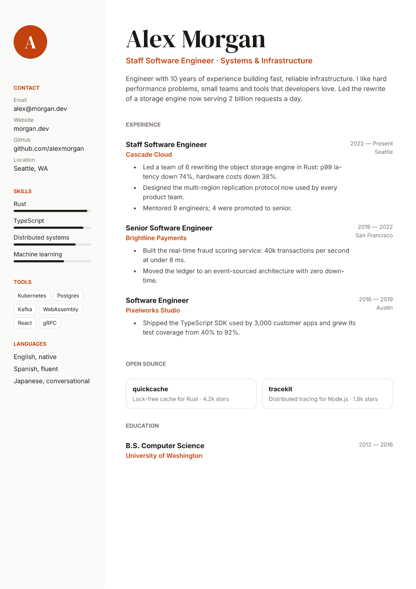

<div align="center">

# ⚡ TurboPDF

**HTML, React or Markdown → PDF in milliseconds. No browser. No network. Same bytes every time.**

A native Rust layout engine behind a tiny TypeScript API, **built to be written by AI**. Drop Puppeteer and keep your templates.

[](https://github.com/noeLienard/turbopdf/actions/workflows/ci.yml)
[](https://www.npmjs.com/package/turbopdf)
[](LICENSE)


[](llms.txt)

<a href=".github/assets/invoice.pdf"></a>
<a href=".github/assets/report.pdf"></a>
<a href=".github/assets/resume.pdf"></a>
<br/>
<a href=".github/assets/ticket.pdf"></a>

<sub>Real output, not retouched. Click one for its PDF, or read its source in
<a href="examples/showcase">examples/showcase</a>: an invoice in <a href="examples/showcase/invoice.tsx">React</a>, a report with SVG charts in <a href="examples/showcase/report.html">HTML</a>, a résumé in <a href="examples/showcase/resume.html">HTML</a>, and a pass built with <a href="examples/showcase/ticket.tsx">components</a>.</sub>

</div>

---

```bash
npm install turbopdf
```

```ts
import turbopdf from 'turbopdf';

const pdf = await turbopdf.create('<h1>Hello, PDF 👋</h1>');
await pdf.save('hello.pdf');
```

That's the whole setup. You don't download Chrome, build a Docker image or babysit a headless browser.

## Why TurboPDF?

Making a PDF in JavaScript usually means **launching a whole browser** to print one page. That is slow and heavy,
it is painful to deploy on serverless, and every request runs page scripts. TurboPDF replaces the browser with a
purpose-built document engine written in Rust. It does Flexbox, Grid, text shaping, hyphenation and pagination.

- ⚡ **About 40× faster.** A 3-page invoice with 200 rows renders in about **20 ms**. A headless browser needs
  0.7–0.9 s for the same file.
- 🪶 **Nothing else to install.** No Chromium, no system fonts, no Dockerfile. The Inter font is built in.
- 🔒 **Safe for user HTML.** Scripts never run, nothing is fetched over the network, and files are read only
  inside `baseDir`.
- 🎯 **Deterministic.** The same input gives the same bytes on macOS, Linux and WebAssembly, so you can snapshot-test
  your PDFs.
- 📄 **Built for documents.** Table rows are never cut in half and headers repeat on every page. Page numbers,
  `see page 4` references, a table of contents, bookmarks and watermarks are built in.
- ♿ **Accessible by default.** Every PDF is tagged for screen readers. One flag gives you **PDF/UA-1**, the standard
  behind the European Accessibility Act.
- 🤖 **AI-native.** Models already write HTML, Markdown and React well, and TurboPDF takes all three. Your assistant writes
  PDFs without learning anything new. [See below](#-ai-native).
- 🧩 **One API, four sources**: HTML/CSS, React, Markdown, or a typed document tree.

## 🤖 AI-native

TurboPDF is designed so an AI assistant (Claude, Cursor, Copilot…) can add PDF generation to your app in one prompt,
and so an AI agent can produce documents on its own.

- **One function, no setup.** `create(source)` → `save()` / `toResponse()`. There is no browser to install or
  configure, so the assistant has nothing to get wrong.
- **`llms.txt` is included.** The whole API, the CSS that works and the common pitfalls fit on one page, in
  [`llms.txt`](llms.txt) (also shipped in the npm package). Point your assistant at it:
  *"Use turbopdf, read node_modules/turbopdf/llms.txt"*.
- **Formats models already know.** HTML/CSS, Markdown and React need no new DSL to learn. A model can also emit
  the **JSON document tree** directly, typed in `turbopdf/tree`.
- **Errors a model can fix by itself.** Each warning says what went wrong, where, and how to fix it. Invalid trees
  list every problem with its JSON path. Feed them back and render again.
- **It can see its own output.** `pdf.toPng()` gives an image of each page for multimodal models to check, and
  `pdf.preview()` gives HTML for chat UIs.
- **Safe for AI-generated content.** Model output is untrusted input. TurboPDF never runs scripts, never makes network
  requests, and reads files only inside `baseDir`. A prompt-injected document has nothing to call and nowhere to send data.
- **Fast enough for agent loops.** Each render takes milliseconds, so an agent can draft, check and fix many times
  in a second.

```ts
// An agent's self-correcting loop
let html = await model.write('A one-page invoice for Acme, 3 items');
for (let i = 0; i < 3; i++) {
  const pdf = await turbopdf.create({ html });
  if (pdf.warnings.length === 0) return pdf;
  const [page] = await pdf.toPng({ scale: 1 });
  html = await model.fix(html, pdf.warnings.map((w) => w.message), page.toDataUrl());
}
```

## Write it your way

<table>
<tr><th>HTML + CSS</th><th>React</th></tr>
<tr><td>

```ts
await turbopdf.create({
  html: `<h1>Invoice 42</h1>
         <table>…</table>`,
  css: 'h1 { color: #1d4ed8 }',
  format: 'A4',
  margin: '15mm',
});
```

</td><td>

```tsx
const Invoice = ({ id }) => (
  <div style={{ padding: 24 }}>
    <h1>Invoice {id}</h1>
  </div>
);

await turbopdf.create(<Invoice id={42} />);
```

</td></tr>
<tr><th>Markdown</th><th>Components (full control)</th></tr>
<tr><td>

```ts
await turbopdf.create({
  markdown: `# Monthly report

| Month   | Revenue  |
|---------|---------:|
| October | 12 000 € |`,
});
```

</td><td>

```tsx
import { Document, Page, Heading, QR, PageNumber }
  from 'turbopdf/components';

<Document title="Ticket" lang="en">
  <Page footer={<PageNumber format="{page}/{pages}" />}>
    <Heading>Your ticket</Heading>
    <QR value="https://acme.com/t/418" />
  </Page>
</Document>
```

</td></tr>
</table>

## Benchmarks

| | TurboPDF | Headless Chrome |
|---|---:|---:|
| 3-page invoice, 200 table rows | **~20 ms** | 700–900 ms |
| Start-up | **loads one native module** | launches a browser |
| What you ship | **one ~9 MB engine, fonts included** | a full Chromium |

<sub>Measured on Apple Silicon. Browser timings count only printing an already-open page; launching the browser
is extra. Reproduce with `npm run bench` (reports, invoices up to 8,000 rows, Markdown, a framework-size stylesheet).</sub>

## How it compares

| | **TurboPDF** | Puppeteer / Playwright | React-pdf | wkhtmltopdf |
|---|---|---|---|---|
| HTML & CSS input | ✅ **native engine** | ✅ through Chromium | ❌ | ⚠️ old QtWebKit, no Flexbox/Grid |
| React input | ✅ **your own components** | ✅ through SSR | ✅ its own primitives | ⚠️ through SSR |
| Markdown input | ✅ | ❌ | ❌ | ❌ |
| Runs without a browser | ✅ | ❌ | ✅ | ❌ embedded WebKit |
| Safe with untrusted input | ✅ **no scripts, no network** | ⚠️ needs hardening | – | ❌ archived, unpatched |
| Byte-identical output | ✅ | ❌ | ❌ | ❌ |
| Rows never split, headers repeat | ✅ **built in** | ⚠️ print CSS | ⚠️ manual | ⚠️ print CSS |
| Tagged PDF / PDF/UA | ✅ **default / one flag** | ⚠️ experimental | ❌ | ❌ |
| HTML preview of the PDF | ✅ | ❌ | ❌ | ❌ |

## Everything included

| | |
|---|---|
| 🎨 **CSS** | Flexbox, Grid (`fr`, `repeat()`), `calc()`, `var()`, `@page`, `@media print`, `::before`/`::after`, `position: absolute`, `@font-face` |
| 🔤 **Text** | Real shaping (kerning, ligatures), hyphenation from `lang`, your own TTF/OTF fonts |
| 🖼️ **Images** | PNG, JPEG, WebP, GIF, and SVG kept as **vectors**, including inline `<svg>` |
| 🔳 **QR codes** | ``, `` or `<QR>`, drawn as vectors: SEPA/EPC payments, tickets, links |
| 📑 **Long documents** | Headers and footers with `{page}/{pages}`, table of contents, `see page N`, bookmarks, page breaks, keep-together |
| 🔗 **Links** | External links and internal `#id` jumps, clickable in the PDF |
| 💧 **Stamps** | `watermark: 'PAID'` on every page |
| ♿ **Accessibility** | Tagged PDF by default. `pdfua: true` checks the title, language, alt text and that every character has a glyph |
| 👀 **Preview** | `pdf.preview()` returns real HTML/CSS (selectable text, working links, light fonts), and `pdf.toPng()` returns images |
| 🔥 **Live reload** | `npx turbopdf dev invoice.tsx` renders the PDF again on every save |
| ⚠️ **Warnings, not crashes** | Overflow, missing glyph, broken link… each warning says how to fix it. Use `strict: true` in CI |

## Ship it

Return a web `Response` from **Next.js**, **Hono**, **Bun** or **Deno**:

```tsx
// app/api/invoice/route.tsx
import turbopdf from 'turbopdf';

export async function GET() {
  const pdf = await turbopdf.create(<Invoice />);
  return pdf.toResponse({ filename: 'invoice.pdf', disposition: 'attachment' });
}
```

With **Express**, stream it: `pdf.toStream().pipe(res)`. Renders run on Node's thread pool and never block
your event loop.

## Preview as HTML, not images

```tsx
const preview = await pdf.preview();

<style dangerouslySetInnerHTML={{ __html: preview.style }} />
{preview.pages.map((p) => <div key={p.page} dangerouslySetInnerHTML={{ __html: p.html }} />)}
```

Each page is real HTML/CSS, laid out by the same engine as the PDF. You can select text and find it with Ctrl+F,
and links work. Fonts are cut down to the glyphs you use, about 200 KB a page. The preview looks the same whether
you wrote HTML, Markdown or React.

## Documentation

📖 **[The full guide](docs/guide.md)**: every option, supported HTML and CSS, Markdown, components, QR codes,
accessibility, warnings and errors.

🦀 **[The engine](engine/README.md)**: a Rust workspace (tree → layout → PDF / PNG / HTML) that also builds for
WebAssembly.

## Contributing

Issues and PRs are welcome. Read [CONTRIBUTING.md](CONTRIBUTING.md), then:

```bash
npm install && npm run build:native && npm run check
```

If TurboPDF spared you from shipping a browser, **⭐ star the repo**. It helps other people find it.

## License

[MIT](LICENSE)
