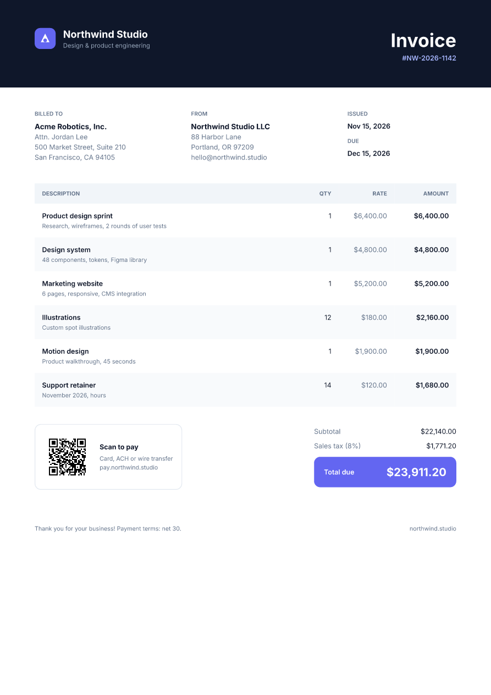

<div align="center">

# ⚡ TurboPDF

**HTML, React or Markdown → PDF in milliseconds. No browser. No network. Same bytes every time.**

A native Rust layout engine behind a tiny TypeScript API, **built to be written by AI**. Drop Puppeteer and keep your templates.

[](https://github.com/noeLienard/turbopdf/actions/workflows/ci.yml)
[](https://www.npmjs.com/package/turbopdf)
[](LICENSE)


[](llms.txt)

<a href=".github/assets/invoice.pdf"></a>
<a href=".github/assets/report.pdf"></a>
<a href=".github/assets/resume.pdf"></a>
<br/>
<a href=".github/assets/ticket.pdf"></a>

<sub>Real output, not retouched. Click one for its PDF, or read its source in
<a href="examples/showcase">examples/showcase</a>: an invoice in <a href="examples/showcase/invoice.tsx">React</a>, a report with SVG charts in <a href="examples/showcase/report.html">HTML</a>, a résumé in <a href="examples/showcase/resume.html">HTML</a>, and a pass built with <a href="examples/showcase/ticket.tsx">components</a>.</sub>

</div>

---

```bash
npm install turbopdf
```

```ts
import turbopdf from 'turbopdf';

const pdf = await turbopdf.create('<h1>Hello, PDF 👋</h1>');
await pdf.save('hello.pdf');
```

## The problems it solves

| You have this problem | TurboPDF |
|---|---|
| 👀 **The preview in your app is not the PDF people download.** Page breaks, fonts and margins move. | The preview is drawn from **the same layout as the PDF**. [See below](#a-preview-that-matches-the-download). |
| 🐘 **Chrome eats memory**, leaves zombie processes and bloats your Docker image. | No browser: one native module (~11 MB, fonts included). |
| 🥶 **Slow cold starts and timeouts on serverless.** | Nothing to launch. A 3-page invoice renders in **~20 ms**, about 40× faster than a headless browser. |
| 🕳️ **User or AI-generated HTML can reach your network or files** (SSRF, `file://`). | No network, no scripts. Files are read only inside `baseDir`. |
| 🎲 **It looks different locally and in production.** | Same input, same bytes, on every machine: snapshot-test your PDFs. |
| 🔤 **A font is replaced without warning.** | `missing_glyph` and `font_failed` warnings name the character or file and say what to do. |
| ✂️ **Table rows cut in half, headers lost on page 2.** | Rows are never split, and table headers repeat on every page. |
| ♿ **Accessibility laws (European Accessibility Act) require accessible PDFs.** | Every PDF is tagged for screen readers. `pdfua: true` gives **PDF/UA-1**. |
| 🧓 **Stuck on wkhtmltopdf** (archived, no Flexbox, no security fixes). | Still HTML and CSS in, now with Flexbox and Grid: your templates move over. |

## Write it your way

<table>
<tr><th>HTML + CSS</th><th>React</th></tr>
<tr><td>

```ts
await turbopdf.create({
  html: `<h1>Invoice 42</h1>
         <table>…</table>`,
  css: 'h1 { color: #1d4ed8 }',
  format: 'A4',
  margin: '15mm',
});
```

</td><td>

```tsx
const Invoice = ({ id }) => (
  <div style={{ padding: 24 }}>
    <h1>Invoice {id}</h1>
  </div>
);

await turbopdf.create(<Invoice id={42} />);
```

</td></tr>
<tr><th>Markdown</th><th>Components (full control)</th></tr>
<tr><td>

```ts
await turbopdf.create({
  markdown: `# Monthly report

| Month   | Revenue  |
|---------|---------:|
| October | 12 000 € |`,
});
```

</td><td>

```tsx
import { Document, Page, Heading, QR, PageNumber }
  from 'turbopdf/components';

<Document title="Ticket" lang="en">
  <Page footer={<PageNumber format="{page}/{pages}" />}>
    <Heading>Your ticket</Heading>
    <QR value="https://acme.com/t/418" />
  </Page>
</Document>
```

</td></tr>
</table>

## A preview that matches the download

```tsx
const preview = await pdf.preview();

<style dangerouslySetInnerHTML={{ __html: preview.style }} />
{preview.pages.map((p) => <div key={p.page} dangerouslySetInnerHTML={{ __html: p.html }} />)}
```

Showing an HTML template in the browser and printing it to PDF on the server gives two different documents: page
breaks, fonts and margins move. Here each preview page is real HTML/CSS drawn from **the very layout that wrote the
PDF**, computed once: every line and every page break is in the same place. You can select text and find it with Ctrl+F,
and links work. Fonts are cut down to the glyphs you use, about 200 KB a page. The preview looks the same whether
you wrote HTML, Markdown or React.

## 🤖 AI-native

An AI assistant (Claude, Cursor, Copilot…) can add PDF generation to your app in one prompt, and an agent can
produce documents on its own.

- **`llms.txt` is included.** The whole API, the CSS that works and the common pitfalls on one page, also shipped in
  the npm package: *"Use turbopdf, read node_modules/turbopdf/llms.txt"*.
- **Formats models already know.** HTML/CSS, Markdown and React, or the typed **JSON document tree** (`turbopdf/tree`).
  No new DSL to learn.
- **A loop it can close by itself.** Every warning says what is wrong, where, and how to fix it; invalid trees list
  each problem with its JSON path. `pdf.toPng()` lets a multimodal model look at the result.

```ts
// An agent's self-correcting loop
let html = await model.write('A one-page invoice for Acme, 3 items');
for (let i = 0; i < 3; i++) {
  const pdf = await turbopdf.create({ html });
  if (pdf.warnings.length === 0) return pdf;
  const [page] = await pdf.toPng({ scale: 1 });
  html = await model.fix(html, pdf.warnings.map((w) => w.message), page.toDataUrl());
}
```

## vs. the alternatives

| | **TurboPDF** | Puppeteer / Playwright | React-pdf | wkhtmltopdf |
|---|---|---|---|---|
| 3-page invoice, 200 rows | **~20 ms** | 700–900 ms | – | – |
| HTML & CSS input | ✅ **Flexbox, Grid** | ✅ through Chromium | ❌ | ⚠️ old QtWebKit, no Flexbox/Grid |
| React input | ✅ **your own components** | ✅ through SSR | ⚠️ its own primitives | ⚠️ through SSR |
| Markdown input | ✅ | ❌ | ❌ | ❌ |
| Needs a browser | **no** | yes | no | embedded WebKit |
| Tagged PDF / PDF/UA | ✅ **default / one flag** | ⚠️ experimental | ❌ | ❌ |
| Maintained | ✅ | ✅ | ✅ | ❌ archived |

<sub>Measured on Apple Silicon; browser timings count only printing an already-open page. Reproduce with
`npm run bench`.</sub>

## Everything included

| | |
|---|---|
| 🎨 **CSS** | Flexbox, Grid (`fr`, `repeat()`), `calc()`, `var()`, `@page`, `@media print`, `::before`/`::after`, `position: absolute`, `@font-face` |
| 🔤 **Text** | Real shaping (kerning, ligatures), hyphenation from `lang`, your own TTF/OTF fonts. Inter is built in |
| 🖼️ **Images** | PNG, JPEG, WebP, GIF, and SVG kept as **vectors**, including inline `<svg>` |
| 🔳 **QR codes** | ``, `` or `<QR>`, drawn as vectors: SEPA/EPC payments, tickets, links |
| 📑 **Long documents** | Headers and footers with `{page}/{pages}`, table of contents, `see page N`, bookmarks, page breaks, keep-together |
| 🔗 **Links** | External links and internal `#id` jumps, clickable in the PDF |
| 💧 **Stamps** | `watermark: 'PAID'` on every page |
| 🔥 **Live reload** | `npx turbopdf dev invoice.tsx` renders the PDF again on every save |
| 🚦 **CI** | `strict: true` turns warnings into errors |

## Ship it

Return a web `Response` from **Next.js**, **Hono**, **Bun** or **Deno**:

```tsx
// app/api/invoice/route.tsx
import turbopdf from 'turbopdf';

export async function GET() {
  const pdf = await turbopdf.create(<Invoice />);
  return pdf.toResponse({ filename: 'invoice.pdf', disposition: 'attachment' });
}
```

With **Express**, stream it: `pdf.toStream().pipe(res)`. Renders run on Node's thread pool and never block
your event loop.

It runs on **macOS, Linux (glibc and Alpine), Windows, Lambda, Vercel, Docker, Bun and Deno**: prebuilt native
binaries, and the same engine in WebAssembly anywhere else, with the same output bytes.
[Where it runs](docs/guide.md#where-it-runs).

## Documentation

📖 **[The full guide](docs/guide.md)**: every option, supported HTML and CSS, Markdown, components, QR codes,
accessibility, warnings and errors.

🦀 **[The engine](engine/README.md)**: a Rust workspace (tree → layout → PDF / PNG / HTML) that also builds for
WebAssembly.

## Contributing

Issues and PRs are welcome. Read [CONTRIBUTING.md](CONTRIBUTING.md), then:

```bash
npm install && npm run build:native && npm run check
```

If TurboPDF helped you, **⭐ star the repo**: it helps other people find it.

## License

[MIT](LICENSE)
